# Themes

Everything visual lives here: qtile palettes, wallpapers, the GRUB boot
themes, the Cell Tower GTK look, and the Lucid shell. All of it is vendored —
nothing is fetched at build time.

## Quick reference

| Look | Where | Enable with (root `default.nix`) |
| --- | --- | --- |
| qtile bar colours | `palettes/` | `system.qtile_mod.palette = "<name>"` |
| qtile wallpaper | `wallpapers/` | `system.qtile_mod.background = ./theme/wallpapers/<file>` |
| GRUB boot menu | `grub/` | `system.grub_theme.theme = "<name>"` |
| Full desktop (GTK, icons, font) | `celltower/` | `system.celltower.enable = true` |
| Hyprland shell | `lucid/` | `system.lucid = { enable = true; theme = "<name>"; }` |

## qtile palettes (`palettes/`)

Each file holds five Material You roles that map onto the qtile theme slots
(`primary` → `primaryLight`, `surface` → `primaryDark`, `secondary` →
`secondaryLight`, `surface_container_high` → `secondaryDark`,
`surface_variant` → `neutral`).

| Palette | Swatch | Look | primary | surface | secondary |
| --- | --- | --- | --- | --- | --- |
| `evangelion` |  | The original custom theme — deep red accents, green highlights, dark blue-grey base | `#a22a32` | `#1e272a` | `#24e189` |
| `celltower` | 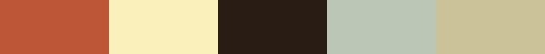 | Light and warm — terracotta accent on cream, sage-grey surfaces (matches the Cell Tower GTK theme) | `#BD5636` | `#FAF0BB` | `#281C14` |
| `rumda` | 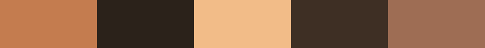 | Warm dark brown — copper/tan accents, cosy earthy tones (from [rumda](https://github.com/Nytril-ark/rumda); desktop preview below) | `#c47c4f` | `#2B221A` | `#f2bc88` |
| `rumda-light` | 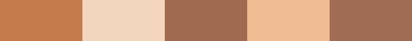 | The light rumda variant — warm cream base, same copper accents | `#c47c4f` | `#F2D5BB` | `#a1694d` |
| `caelestia` |  | Cool dark blue-grey with light blue/lavender accents (from [caelestia-dots](https://github.com/caelestia-dots/shell)) | `#9ccbfb` | `#101418` | `#d3bfe6` |
| `ariealerr` |  | Muted periwinkle/mauve on deep indigo, derived from the [ariealerr/dots](https://github.com/ariealerr/dots) wallpaper (`wallpapers/ariealerr.png`; preview below) | `#738BBB` | `#1F2036` | `#91749D` |
| `tokyo-night` |  | Cool dark blue, blue/violet accents | `#7aa2f7` | `#1a1b26` | `#bb9af7` |
| `gruvbox` |  | Retro warm dark — aqua and faded pink on brown-grey | `#83a598` | `#282828` | `#d3869b` |
| `catppuccin-mocha` |  | Soft pastel blue/lavender on dark purple-grey | `#89b4fa` | `#1e1e2e` | `#cba6f7` |
| `nord` |  | Muted arctic teal/blue on blue-grey | `#88c0d0` | `#232831` | `#81a1c1` |
| `nightfox` |  | Deep blue-charcoal, blue and cyan accents | `#719cd6` | `#192330` | `#63cdcf` |
| `pywal` |  | Muted purple base, cyan/peach accents | `#47D5FB` | `#301e37` | `#F9C9A2` |

Swatches read left to right: primary, surface, secondary, surface_container_high, surface_variant.

Desktop previews:

| rumda (dark) | rumda (light) | ariealerr wallpaper |
| --- | --- | --- |
| 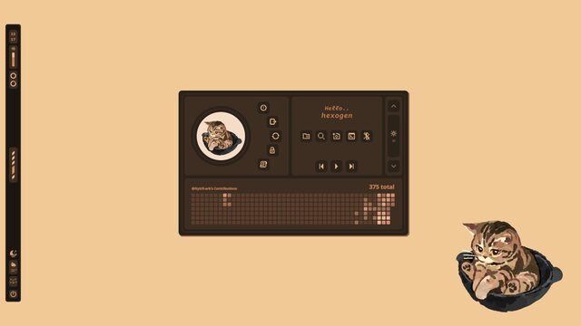 | 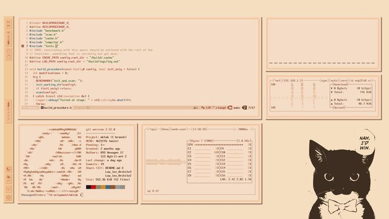 | 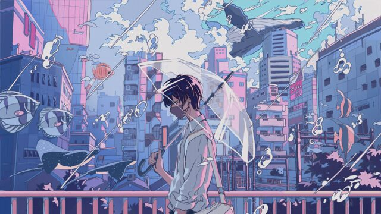 |

The active palette also generates a matching **rofi theme** (`~/.config/rofi/qtile-palette.rasi`) — the launcher (`SUPER+D`) follows the palette automatically.

Set it in the root `default.nix`:

```nix
config.system.qtile_mod.palette = "gruvbox";
```

`palette = "custom"` ignores the files and uses an explicit
`theme = { primaryLight = ...; ... }` block instead; any `theme.*` value you
set overrides the palette. To add a palette: drop `<name>.json` (roles
`primary`, `secondary`, `surface`, `surface_container_high`,
`surface_variant`) into `palettes/` and add `<name>` to `paletteNames` in
`system/tiling_manager/qtile/default.nix`.

## Wallpapers (`wallpapers/`)

qtile wallpapers. Point `system.qtile_mod.background` at any file here (or
any path). The Evangelion 4K wallpapers matching the GRUB themes live in
`grub/wallpapers/`.

## GRUB boot themes (`grub/`)

Eight Evangelion themes from
[Aleph1-9012/Evangelion](https://github.com/Aleph1-9012/Evangelion), each in
720p/1080p/1440p, drawn as horizontal NERV-style cards by a bundled native
GRUB module. Matching 4K wallpapers in `grub/wallpapers/`.

| Theme | Look | Preview |
| --- | --- | --- |
| `soryu` | Asuka — red/blue NERV card styling | 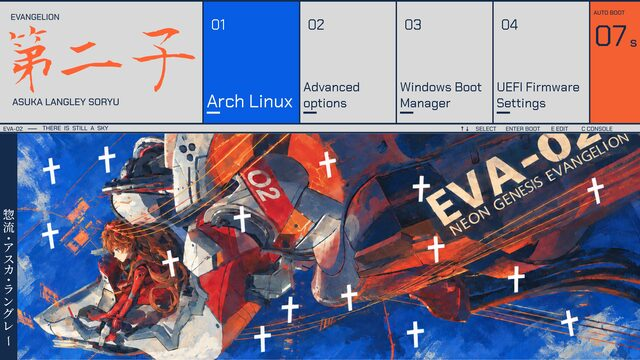 |
| `ayanami` | Rei — pale blue/white | 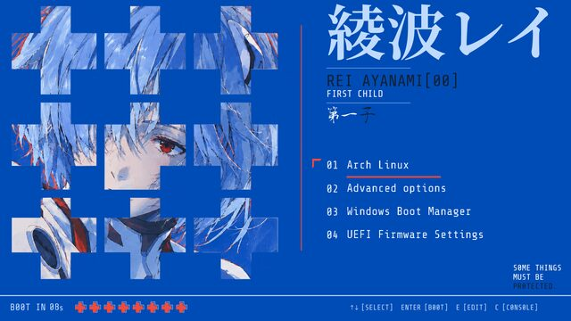 |
| `eva01` | Unit-01 — purple/green | 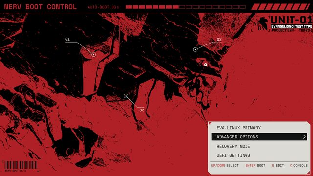 |
| `eva02` | Unit-02 — red/orange | 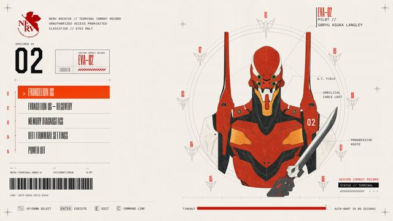 |
| `penpen` | Pen-Pen — playful light card art | 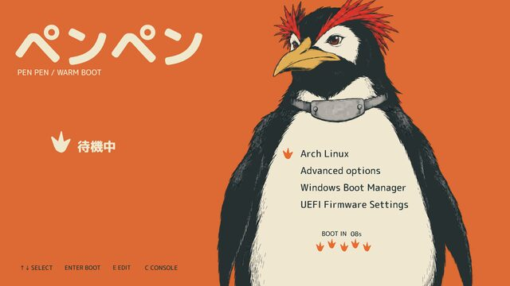 |
| `ramiel` | Ramiel — blue geometric octahedron | 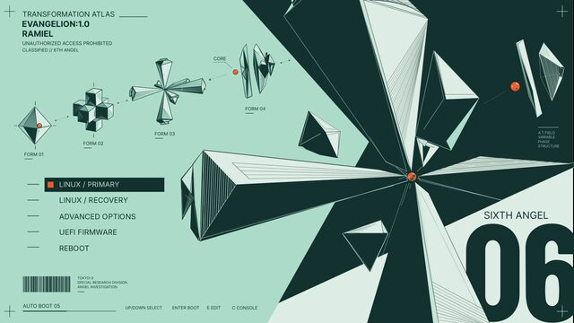 |
| `seele` | SEELE — monolith / stone tablet motif | 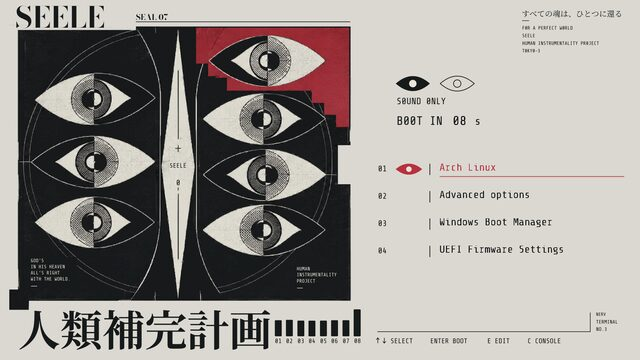 |
| `wunder` | Wunder — clean white/blue WILLE styling | 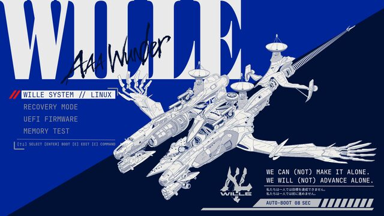 |

```nix
config.system.grub_theme = {
  enable = true;          # switches the bootloader from systemd-boot to GRUB
  theme = "soryu";
  resolution = "1440p";   # 720p | 1080p | 1440p
};
```

`system.grub_theme.wallpaper` (read-only) points at the matching
`grub/wallpapers/<theme>.png` if you want the desktop to match.

## Cell Tower (`celltower/`)

The full [Cell Tower](https://gitlab.com/dejan-z/xfce-stuff/-/tree/main/Cell%20Tower)
look for qtile/X11: light cream/terracotta GTK 2/3 theme, 4K wallpaper,
GohuFont 11 Nerd Font, thunar + ranger. Terminal stays kitty.

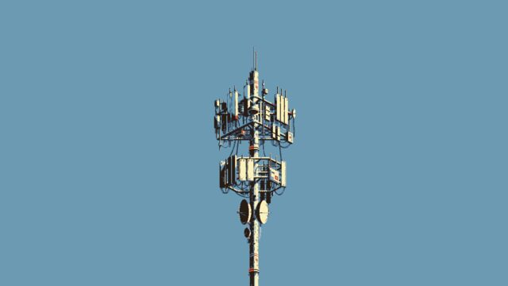

```nix
config.system.celltower.enable = true;
```

While enabled it overrides (`mkOverride 90`) the qtile palette, wallpaper and
terminal; disable it and your own settings return. Icon pack wiring is
available via `system.celltower.iconTheme = { name = ...; package = ...; }`.

## Lucid shell (`lucid/`)

The [Lucid](https://github.com/Sn3akyy1/lucid) Quickshell desktop
(Material You bar, dock, widgets, lock screen) as a Hyprland session at the
GDM login screen — qtile stays untouched. Theme switching is
config-driven and live-reloads:

```nix
config.system.lucid = {
  enable = true;
  theme = "gruvbox";  # matugen | catppuccin-mocha | gruvbox | nightfox |
                      # nord | pywal | tokyo-night | <custom>
  mode = "dark";      # dark | light
};
```

`matugen` generates the palette from the current wallpaper. Custom themes:
drop `<name>/quickshell.json` into `~/.config/lucid/themes/` and set
`theme = "<name>"`. Lucid's keybinds are seeded from
`lucid/shell/support/hypr/keybinds.json` (already ported from the qtile
binds) and are editable live in Settings → Keybinds.
